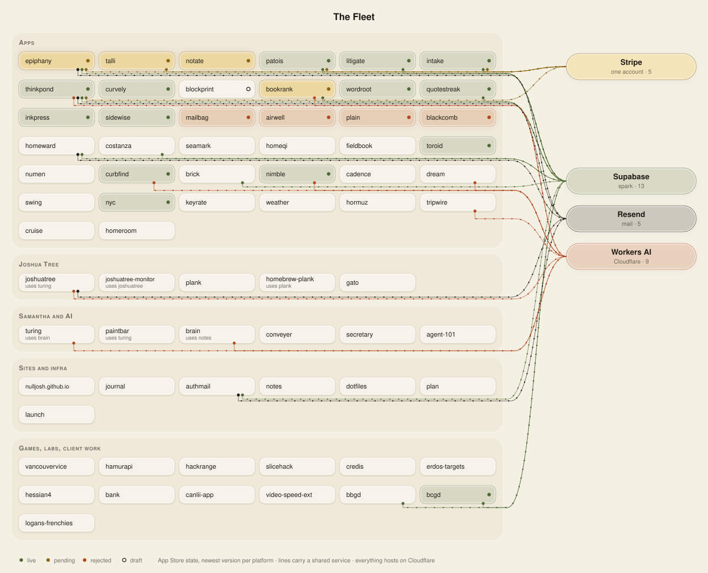

# Codebase Notes (~/Documents/Code)

*Refreshed 2026-10-20. This file is a map. Each repo's `CLAUDE.md` and `roadmap.md` hold the detail. `GTM.md` holds the money. Never write versions here, `asc versions list --app <id>` is the truth.*

## Environment
- Mac Mini M4 · Python 3.14 · Node 24 · xcodegen at `/opt/homebrew/bin/xcodegen`
- `asc` CLI and its skills are installed. Use them. Stay out of the App Store Connect dashboard.

## Repos

**`~/Documents/Code` is the `labs` repo.** 21 projects live in it as plain folders, history kept, and commit to `labs`: keyrate, weather, noema (ex-evidna, absorbed the old noema repo 2026-10-26), plan, hormuz, tripwire, cadence, fieldbook, dream, seamark, costanza, numen, homeqi, sighting (ex-sighting, ex-homeward), dotfiles, journal, toroid, coda (ex-quotestreak), hamurapi, bcgd, bugle (ex-coranto, ex-inkpress), horula (ex-clock). Icelus (ex-Glyphbox, ex-Glyphic, ex-Blockprint) left on 2026-10-18 and is its own repo (`nulljosh/icelus`, folder `icelus/`, ignored here). Curvely, now Pan (renamed 2026-10-21, store name still Curvely until Apple accepts), left the same way on 2026-10-21 (`nulljosh/pan`, public, folder `pan/`, ignored here; its earlier history stays in labs), and so did Gastown, ex-NYC Survive (`nulljosh/gastown`, public, folder `gastown/`). Oohaah left on 2026-10-25 (`nulljosh/oohaah`, private for now, folder `oohaah/`, history kept). Their CI is `.github/workflows/<name>-*.yml` at the root, native builds tag `<name>-native-v*`. Private side projects (hackrange, secretary, slicehack, logans-frenchies) live in the private `vault` repo at `vault/`. Old per-repo bundles are in `_attic/folded/`. `plan/` is on disk and in the allowlist but untracked, see roadmap. The tracked non-project folders are `authmail`, `bank`, `canlii-app`, `credis`, `agent-101`, `video-speed-ext`, `launch`, `runs`, `scripts`. 

### Apps
Domains are `<name>.jaybulb.com` unless noted. A number is the ASC app id.

| Repo | What |
|---|---|
| **nimble** | Instant answers, menu bar + web. **The reference repo** |
| **epiphany** | Finance dashboard · 6779522175 |
| **talli** | BC disability assistance tracker (DTC/RDSP/CDB) · 6782366555 |
| **echo** (ex-notate, ex-voxprint, first named echo) | On-device transcription, WhisperKit. Store listing still Notate until Apple takes Echo; Xcode targets and Pages project still say Voxprint · 6782604262 |
| **patois** (ex-tonchi, ex-lexly). Folder is `patois` | Gamified learning, 125 courses · 6783501611 (6783501927 is a stray dupe) |
| **machaon** (ex-intake, ex-healstack). Own repo, not in labs | Dose log, harm reduction library and health dashboard, named for the healer son of Asclepius. Pages project and bundle id stay `healstack`/`dose`; intake.jaybulb.com still serves · 6785764864 |
| **melete** (ex-thinkpond, ex-hikko, ex-sparkjar). Folder is `melete` | Idea feed, named for the Muse of thought. Pages project still `sparkjar`; thinkpond. and hikko. hosts still serve · 6785162492 |
| **mailbag** (ex-hagaki, siftbox, pare, sieve) | Inbox zero in one button. Store listing renamed Mailbag and resubmitted 2026-10-18; Google callback still on hagaki.jaybulb.com · 6811141466 |
| **bookrank** | Book summaries, listen feature |
| **pan** (ex-tangent, ex-curvely, store still Curvely). Own repo, not in labs | Desmos-style grapher: functions, lists, sliders, 85 patterns · 6794988370 |
| **icelus** (ex-morphis, ex-morpheus, ex-glyphbox, ex-glyphic, ex-blockprint, ex-blockframe, ex-wiretext). Own repo, not in labs | Describe a screen and it takes shape: a design tool on a real canvas, text underneath. Domain icelus.jaybulb.com; Pages project and bundle ID still `wiretext` · 6794988951 |
| **hermes** (ex-tiller, ex-bosun, ex-palaemon, ex-talaria). Own repo, not in labs | Native Mac app for App Store Connect, a one-to-one clone of Helm over asc. Landing hermes.jaybulb.com |
| **wordroot** | Etymology lookup |
| **coda** (ex-quotestreak) | Quote guessing game at coda.jaybulb.com. Store listing, Pages project, storage keys and RPCs still say quotestreak · 6804394619 |
| **bugle** (ex-coranto, ex-inkpress) | Multi-feed RSS reader with Ground News-style coverage, renamed Coranto to Bugle 2026-10-25 (store name "Bugle News"; Apple refused plain Bugle). Store listing says Inkpress until the next version ships; Pages project, bundle id (`com.nulljosh.journal`) and inkpress.jaybulb.com stay · 6787759999 |
| **sidewise** | RSS bias API + reader · 6806028670 |
| **plaintxt** | Plain text editor, iOS + macOS + CLI |
| **blackcomb** (ex-madobe, ex-lucarne) | WebKit browser: start page, reading list, Float, Pair, site rules. Mac automation built and held until the Mac review clears. Bundle ID `com.nulljosh.lucarne` and Worker name `madobe` stay · 6809355192 |
| **airwell** (ex-windgate) | Guided breathing. Folder is `breathe` · 6810806058 |
| **scrounger** (ex-scrounge, ex-curbfind, ex-curbside). Own repo `nulljosh/scrounger`, folder `scrounger` (`scrounge` is a symlink) | Craigslist browser, every platform · 6809031662 |
| **atlin** (ex-brick, ex-roost) | Real rentals on a map, deal-ranked, 27 languages. Bundle ID still `com.nulljosh.brick`, Pages project still `roost` (neither can be renamed) · 6824157219 |
| **hamurapi** (ex-hamurabi) | 1968 Hamurabi with a drawn city. Bundle ID and Worker still `hamurabi` · 6819131590 |
| **toroid** | Game of Life on a torus · 6806324937 |
| **gastown** (ex-nyc, ex-NYC Survive). Own repo, not in labs | Vancouver colony game: a crew, self-running machines, raise the Steam Clock. Store listing still NYC Survive until 2.0.0 ships; bundle ID and Worker stay `nyc` · 6782618198 |
| **bcgd** | Garage-door site, ships as **Doorstock** · 6791106082 |
| **temida** (ex-themis, ex-atticus, ex-litigate) | Litigation tool, public repo (old history in private `temida-private`). Landing at temida.jaybulb.com (themis., atticus. and litigate. still serve); Pages project `themis`, bundle id and litigate:// scheme keep old names · 6787857503 |
| **homeqi** | Feng shui home assessment (web, iOS reader-only) |
| **sighting** (ex-sighting, ex-homeward) | Lost/found pets, web + iOS + KMP. Pages project, bundle id `com.nulljosh.homeward` and `homeward://` scheme keep the old name |
| **homeroom** (ex-lec) | Private D2L quiz app |
| **costanza** | Poetry network, shared spark table `stanza_poems` |
| **oohaah** (ex-swing). Own repo, not in labs | Random 1:1 video chat, Durable Object lobby. Bundle ID `com.nulljosh.oohah` (one a short) · 6825014407 |
| **dream** | Dream journal, Workers AI |
| **cadence** | Commit-history tracker |
| **numen** | Free-form calculator canvas |
| **tripwire** | API drift and CI-failure watcher |
| **seamark** | Read values off rendered charts (npm lib) |
| **horula** (ex-Clock) | iOS Clock on the web, going native: world clocks, alarms, sleep, stopwatch, timers, nightstand. PWA at horula.jaybulb.com (clock.jaybulb.com still serves); App Store record 6826916379 |
| **keyrate** | Typing test, one file |
| **weather** | Forecast page, Open-Meteo, one file |
| **fieldbook** | Every field of science + math explained plainly |
| **hormuz** | Strait of Hormuz, oil prices, trading signals |
| **noema** (STEM lab, ex-evidna) | One lab, a lane per field: `math/` (Collatz, SAT, Lean), `cs/` (Busy Beaver), `biology/` (HBB, ex-Evidna); more queued in its roadmap. One site, `./deploy.sh`; noema.jaybulb.com and evidna.jaybulb.com |

### Big projects
| Repo | What |
|---|---|
| **joshuatree** | From-scratch i386 and Pi 4 OS: desktop, Wi-Fi, HTTPS browser, Samantha relay. |
| **turing** | Pipeline for small on-device language models. First model: Samantha. |
| **plank** | Small compiled language, one Python file. `homebrew-tap` is the one tap for plank-lang and nimble |
| **vancouvervice** | GTA-style game in the real Vancouver, Unreal 5 |
| **conveyer** | Claude plays Factorio, now Game Dev Tycoon |
| **duke** (ex-surf, ex-cruise, ex-pwnlingo). Own repo, named for Duke Kahanamoku | Plays while you sleep: Duolingo, Factorio, Game Dev Tycoon, FEZ. Apache 2.0. The runner must stay up. Menu bar app at ~/Applications/Duke.app under launchd (label still com.nulljosh.cruise-status). duke.jaybulb.com; `surf` is a symlink to the folder |
| **gato** | Voice-first OS shell, local-only repo. "Leopard Gecko" is reserved for Joshua Tree's future distro |

### Sites & infra
| Repo | What |
|---|---|
| **nulljosh.github.io** | Portfolio, jaybulb.com. Pages project `jaybulb` |
| **journal** | Jekyll blog (Pages project `journal-heyitsmejosh`) |
| **notes** | Notes repo, source of truth for the Obsidian vault copy |
| **brain** | RAG over notes, bearer-gated /api + /mcp |
| **jaybulb-api** | Cloudflare Worker on D1 and KV: sign-in, data rules, photos, mail for web apps at api.jaybulb.com |
| **authmail** | Auth email branding + Resend delivery Worker |
| **dotfiles** | Shell configs, skills |

### Small or local-only
`secretary` (Claude + Twilio phone secretary), `hackrange` (security dojo, private), `slicehack`, `logans-frenchies` (client pitch, private), `bbgd` (client site), `bank`, `canlii-app`, `credis`, `agent-101`, `video-speed-ext`, `launch` (post drafts), `runs`. Old experiments and stray copies live in `_attic/` (gitignored, never push). Helpers: `scripts/`, `_external/` (read-only checkouts, never push).

Gone. Don't mention them: systems, beep, missing-pets, abraham, code-meta, charters, nimble-web, uprighty, life, school/lingo/parlay.

## Ship status
Standing: a 4.3(a) spam wave hit 7 apps on 2026-08-28 and again on 2026-10-05. Reply with the nine answers, never resubmit unchanged, and send nothing without Joshua's yes. Book apps get a vague 2.1 unless you drop CHN. Rejection reasons live in Resolution Center only (`asc-login` for 2FA). The ledger is `wiki/pages/asc-status.md` in the Obsidian vault, regenerate it, don't trust it.

## Stack
- **Auth**: web apps use jaybulb-api (email+password, Apple and Google id tokens, per-table rules). Reset and confirm mail goes through authmail via Resend. Supabase (shared `spark` project) stays only for installed native apps until their new builds ship.
- **Hosting**: Cloudflare Pages and Workers. Deploys are `wrangler pages deploy`. **A push deploys nothing.**
- **DNS**: curl with `CLOUDFLARE_DNS_TOKEN` from `~/.config/fish/secrets.fish`. Not named `CLOUDFLARE_API_TOKEN` on purpose, that name breaks wrangler's OAuth.
- **Apple**: xcodegen `project.yml`, no checked-in xcodeproj. SwiftUI, iOS 17+/macOS 14+. `asc xcode archive`/`export`.
- **Other platforms**: Kotlin Multiplatform under `<repo>/kmp/`. A PWA is a fallback and does not count as coverage.
- **/api + /mcp**: house Cloudflare Functions pattern (coda, bookrank, wordroot, curvely, icelus).
- No emojis in any UI. No demo accounts for screenshots. Use the gitignored `.env`.

## Repo standard (nimble is the reference)
- `README.md`: `icon.svg` at 80px, version / MIT badges (tests too where CI runs), live link, Features. No H1, no banner image, no GitHub badge (Joshua, 2026-10-16; nimble is the model).
- `LICENSE` (MIT 2026 Joshua Trommel), `SECURITY.md`, `CLAUDE.md`, `WHITEPAPER.md`, `architecture.svg`, `icon.svg`. `AGENTS.md` is a symlink to `CLAUDE.md`.
- `WHITEPAPER.md`: H1 `<Name> Technical Whitepaper`, `**vX** | Month Year`, one-paragraph summary, core mechanic first, MIT footer, about 40 to 60 lines. Write it before the first push.
- `.github/workflows/test.yml` where tests exist. GitHub description, homepage, topics set.
- Icons 200x200 dark terminal style. Architecture SVGs Apple node-and-line, white bg.
- **Landing in every repo** at `<name>.jaybulb.com` (Worker, `wrangler.toml` + `deploy.sh`, `landing/` or `docs/`), live before the ASC record. The real app runs directly on the page under the hero tagline, with no device frame or window around it (Joshua 2026-10-17). Never a screenshot where the app can run. Built on the shared tokens: 8 point grid, one radius set, 48 point capsule controls, system font. Reference: `airwell/web/index.html` and `wordroot/brand/tokens.css`. Older landings that still use a device frame (nimble `docs/index.html` and others) are being rebuilt.

## Writing (READMEs, whitepapers, CLAUDE.md, roadmaps, journal, landing copy)
tripwire's README is the reference. Short sentences. Plain words. Say the problem, then the thing, then stop. Talk to one person. Cut hedges, jargon, "leverage", "seamlessly", "robust". No em dashes, no emojis, no bullet walls where a sentence works. If it reads like a brochure or an AI wrote it, rewrite it. Prose only, never touches code.

## Credentials
- Cloudflare DNS token: `secrets.fish`. Supabase Management PAT: macOS Keychain.
- On-disk copies of Stripe/Resend/Supabase/Upstash keys may be stale, probe the platform.

## Gotchas
- `heyitsmejosh.com` lapsed 2026-10-13 on purpose. Everything lives at `<name>.jaybulb.com`. Native apps still hardcode the old host until their next build.
- `npm i <pkg> --save-dev` on a pinned dep upgrades it silently. Edit package.json by hand and diff the lockfile.
- Stripe is live on epiphany, machaon, melete and talli. It cannot unlock in-app features under App Review, that needs IAP.
- Social sign-in is blocked on console registrations. The code is done.
- `mole clean` needs a real TTY for sudo. Run it yourself.

## Root files
`README.md` (what labs tracks), `roadmap.md`, `GTM.md`, `SHIPPING.md` (the asc ship method), `README-TEMPLATE.md` (README voice), `progress.svg` + `fleet.svg` (snapshots from `scripts/`).

## Open work
`roadmap.md` is the queue. `GTM.md` is the ledger. About 18 apps still need a `kmp/` module. TUI companions (`tui/` + SwiftTUI) exist for 16 apps, the rest are deliberately skipped (auth-gated, mic-bound or no backend).
