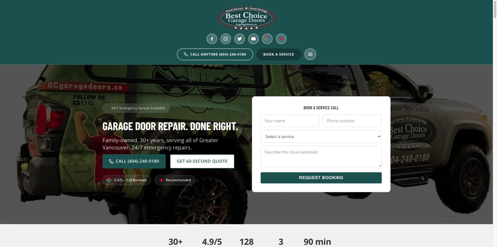
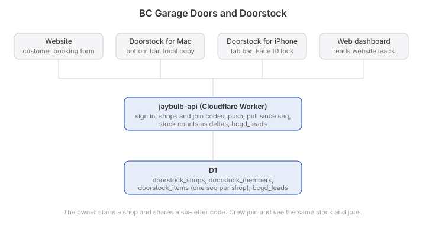

# BC Garage Doors

 

A website and a stock dashboard for Best Choice Garage Doors (bcgaragedoors.ca). One brings customers in. The other tells the shop what's on the shelf.

## Screenshots

## Projects

| Directory | Description | URL |
|-----------|-------------|-----|
| `web/` | Conversion landing page | [bcgd.jaybulb.com](https://bcgd.jaybulb.com) |
| `dashboard/` | Inventory and stock tracker | [bcgd-dashboard.jaybulb.com](https://bcgd-dashboard.jaybulb.com) |
| `ios/`, `macos/` | Doorstock, the stock and jobs app | [doorstock.jaybulb.com](https://doorstock.jaybulb.com) |
| `../prototypes/garage-cam/` | Garage Cam, a shelf camera prototype | open `index.html` on a phone |

## Doorstock features

- Torsion springs by wire size, inside diameter, length and wind, plus cables, rollers, openers and panels, each with a cost
- Snap a label: the camera reads a box and opens that part, or fills in a new one
- Marking a job complete takes its parts off the shelf
- Low-stock alerts and a one-tap reorder email
- A monthly CSV for the accountant: parts used on finished jobs, with cost
- Shared stock and jobs for the whole crew

## License

MIT 2026, Joshua Trommel

## Whitepaper

[Technical whitepaper](WHITEPAPER.md)

## Architecture

