# Screens

Every screen of Doorstock 4.0, captured on an iPhone 17 simulator (dark mode, fake shop data) on 2026-10-21. The Mac app shares the same Swift files, so the screens match; Mac screenshots are not captured yet. The map of how they connect is `storyboard.svg`.

| Screen | What it does | Checked |
|---|---|---|
| Today | The day's jobs in time order, a Route in Maps button each, Complete in one tap, and the parts to load with shortages in red. Jobs assigned to you sort first. | order, shortage flag, Complete |
| Dashboard | Parts in stock, low stock, open jobs, jobs paid, and a reorder email when stock is low. | counts |
| Inventory | Part tiles by category with minus and plus, a Low flag, search. The plus adds a part. | count change, Low flag |
| New part | Name, category, quantity, low stock level. | opens, Save stays off until named |
| Jobs | A column for each status, a plus for a new job. | columns, new job alert |
| Job detail | Status track, customer, address, notes, schedule, parts, assignee (shop members only). | Complete took stock off the shelf |
| Settings | Team, reorder email, stock history, CSV, backup and restore, reset, version. | tiles render |
| Sign in | Email and password, create account. | sheet opens |

Not captured: the Assigned to picker, the shop card and Start or join a shop (they need a signed-in shop), stock history, and the Mac window.

| | |
|---|---|
| 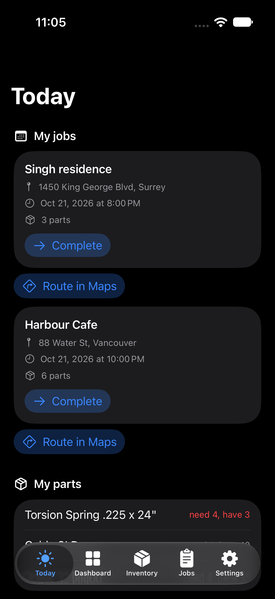 | 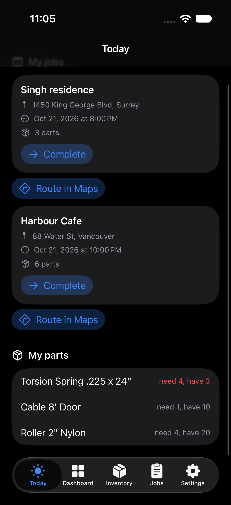 |
| 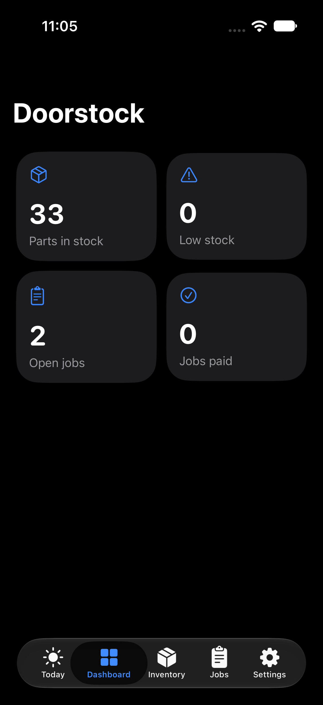 | 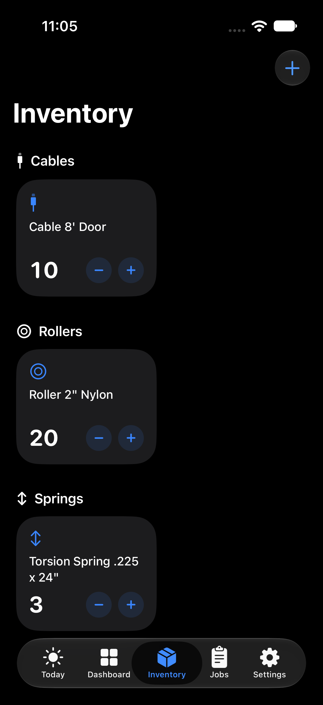 |
| 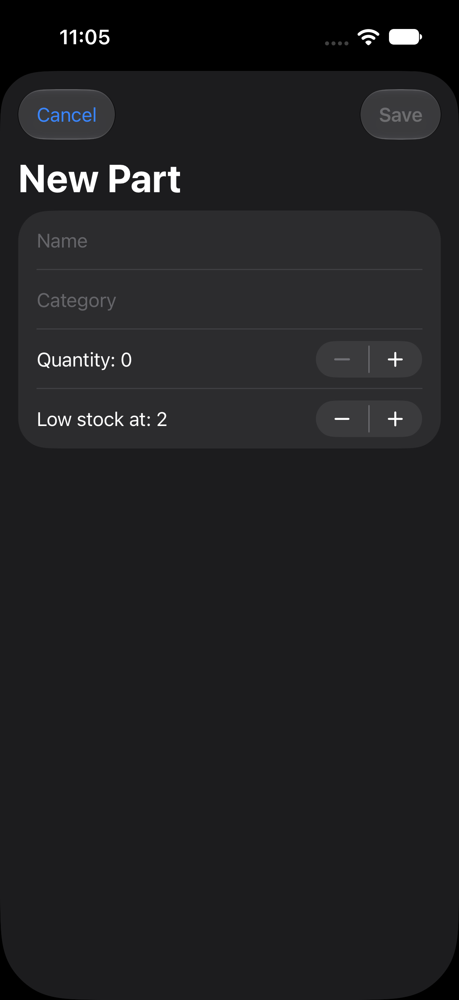 | 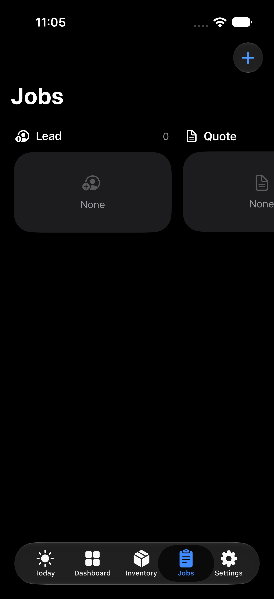 |
| 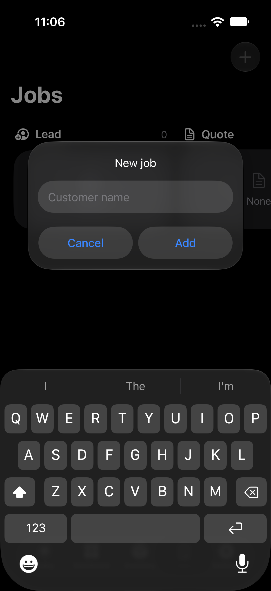 | 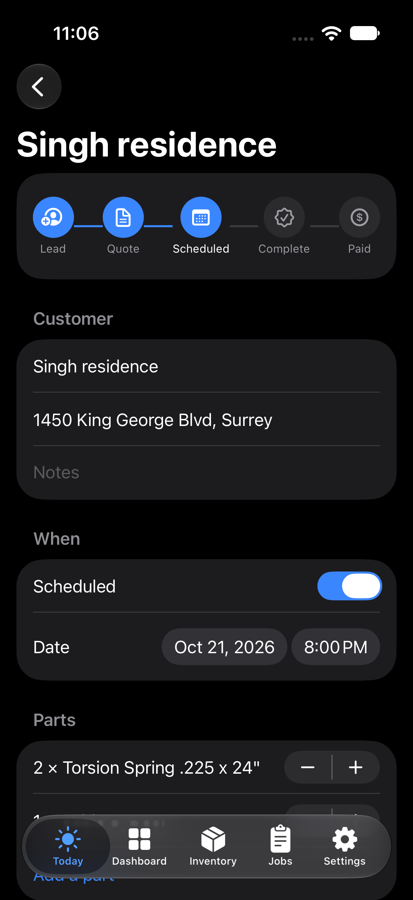 |
| 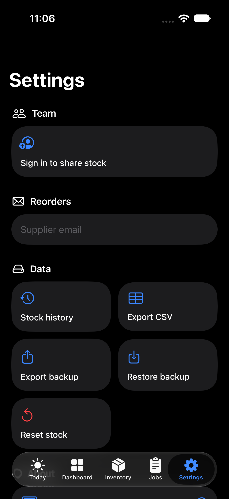 | 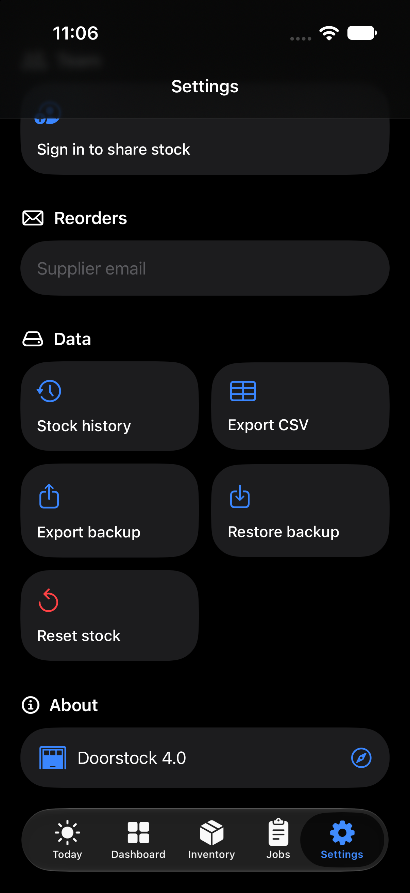 |
| 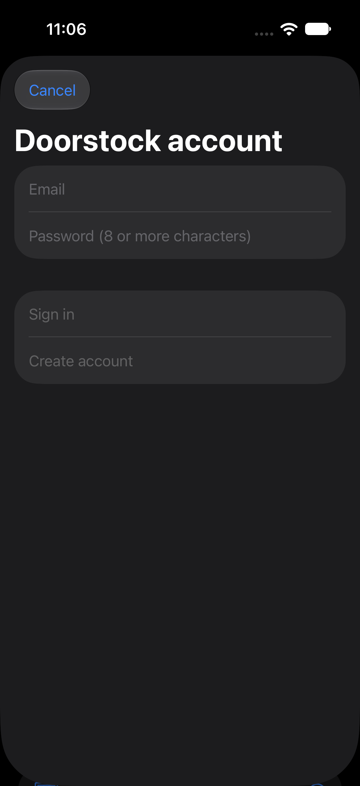 | |
