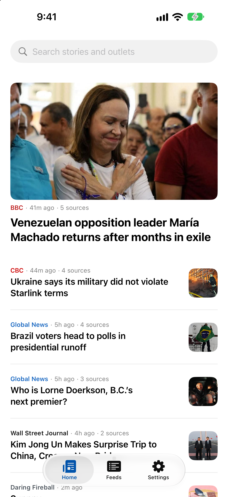
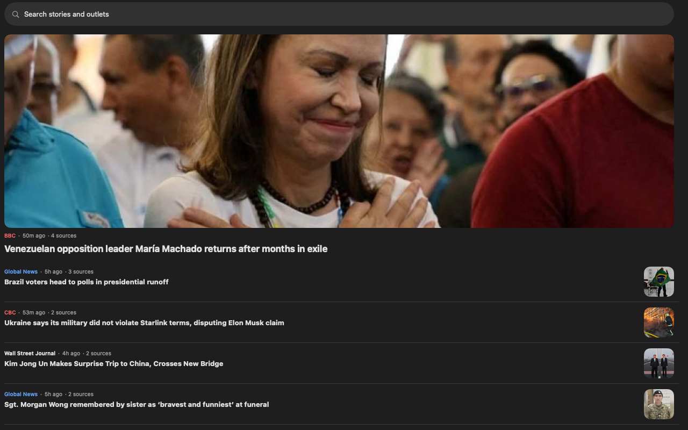
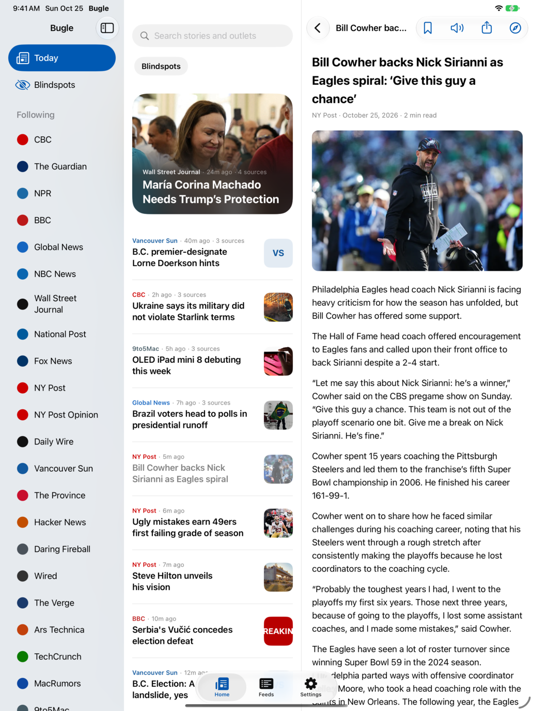
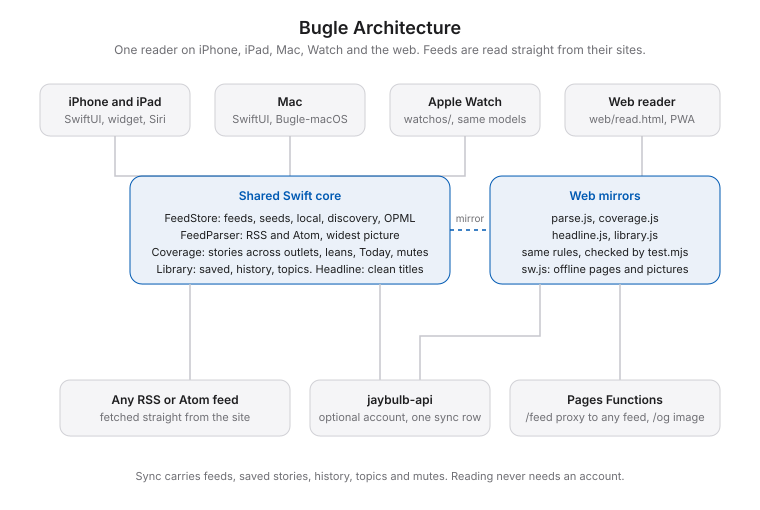

 

Every feed, one timeline. Bugle reads RSS and Atom feeds and puts every story in one stream, with the same story from several newsrooms grouped into one row and the day's biggest stories first. iPhone, iPad, Mac, Apple Watch and the web. Formerly Coranto, and before that Inkpress. On the App Store it is Bugle News.

Live at [bugle.jaybulb.com](https://bugle.jaybulb.com), reader at [bugle.jaybulb.com/read](https://bugle.jaybulb.com/read), app on the [App Store](https://apps.apple.com/app/id6787759999).

<p>
  
  
  
</p>

## Features
- Follow any RSS or Atom feed (paste a site address and Bugle finds its feed), pick from twenty-five newsrooms and tech and Mac sites, or the local desks of ten cities. OPML in and out.
- One row per story: every newsroom that covered it, how left, center and right covered it, and blindspots, with a Blindspots chip on Home to see only those, and the days before under Earlier.
- Today: the five stories the most newsrooms are carrying lead Home.
- Each outlet in its own color; read one outlet and the whole reader takes its color.
- Search stories and outlets, follow a search as a topic, mute an outlet or a word.
- Save stories whole so they open offline, pictures included. History dims what you have read; each feed shows its unread count, and Mark All Read clears them. Stories open in full even when a feed only sends a summary, with their reading time.
- Listen: the system voice reads a story aloud, on device.
- Top Stories widget, "Top stories in Bugle" for Siri and Shortcuts, background refresh, and notifications for the feeds you pick.
- Three columns on iPad and the Mac: outlets, stories and the story side by side. Saved stories show up in Spotlight, an open story hands off to your other devices, and Share → Bugle saves a story or follows a site from Safari.
- Keyboard: j and k through stories, / to search, Esc back, s, l and o on a story; ⌘R, ⌘1 to ⌘3, ⌘S, ⌘L in the apps.
- Your Reading: the lean of what you actually open.
- Optional account that syncs feeds, saved stories, history, topics and mutes across devices and the web.
- In eleven languages, Arabic right to left, in the apps and the web reader.
- No tracking, no analytics, no ads.

## Run
```bash
cd ios && xcodegen generate
xcodebuild -project journal.xcodeproj -scheme Journal-iOS -destination 'generic/platform=iOS Simulator' build
xcodebuild -project journal.xcodeproj -scheme Bugle-macOS build
cd ../watchos && xcodegen generate && xcodebuild -project BugleWatch.xcodeproj -scheme BugleWatch -destination 'generic/platform=watchOS Simulator' build
```

The Watch app compiles the phone's own models and parser from `ios/Sources/Shared`.

## Web
`web/` is static: the landing (`index.html`, which runs the real reader), the reader (`read.html`), and `functions/` for the `/feed` proxy and `/og` preview images. Test with `node test.mjs`. Deploy from this folder, not `web/`, or the functions are left out:

```bash
npx wrangler pages deploy --branch=main
```

## Terminal
`swift build && ./.build/debug/bugle-tui <feed-url>`, see [tui/](tui/).

## Docs
[Whitepaper](WHITEPAPER.md) · [Roadmap](roadmap.md) · [Brand](brand/BRAND.md)



## License
MIT 2026 Joshua Trommel
