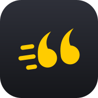
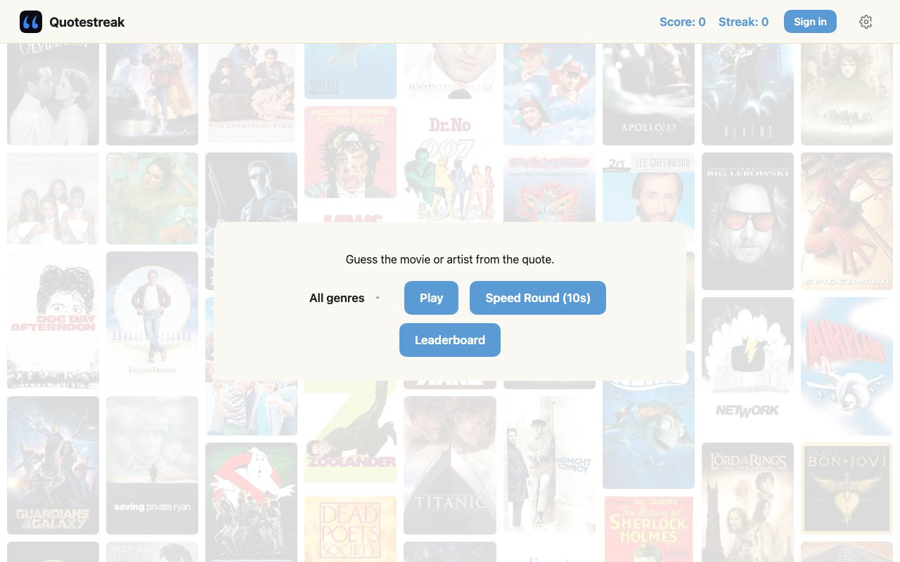
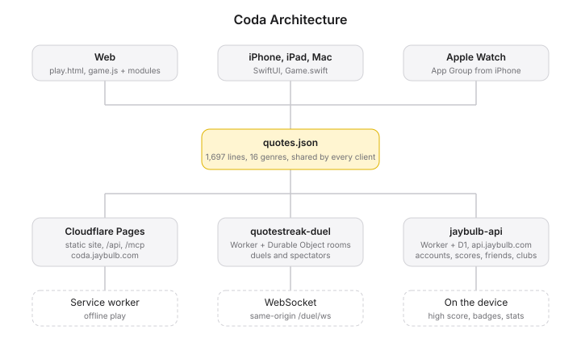

 

Here's the line. Name the movie.

Or the show, the game, the song or the book. 14,434 lines across 16 genres, from the 1930s to now, with a clock if you want one and a friend to beat if you have one. Dad's idea.

**[coda.jaybulb.com →](https://coda.jaybulb.com)** · **[Play →](https://coda.jaybulb.com/play)**

<p>


</p>

## Features

**Guess.** Four choices or type it in. Hints if you turn them on. Filter by genre, decade and difficulty, where difficulty comes from what real players get right. Other ways to guess: who said it, which actor, which director, which album, which book or film gave English a word, Italian and French films in their own words, finish the line, misquotes, said or written (was it improvised?), timeline, poster and album reveal, name the year, and a marathon through every genre on three lives.

**Hands free.** Turn them on in Settings: Quip reads every line aloud, and you say the answer instead of tapping it.

**The story.** After any answer, tap The story for the title's Wikipedia summary and where the line is quoted.

**Practice.** Lines you miss come back on a schedule, a day later, then three, seven and twenty-one, until you know them.

**Suggestions.** Know 80s action? The end screen suggests 80s sci-fi, from your own stats.

**Watchlist.** Films and shows you couldn't name are saved for later, and export straight to Letterboxd.

**Speed round.** Ten seconds a line. Faster answers pay more.

**Daily Quote.** One line a day, the same for everyone, with a day streak.

**Play with people.** Send a friend your ten quotes as a challenge link, duel live, watch someone else's duel, add friends and see a friends-only leaderboard.

**Keep score.** Forty-seven badges drawn around Quip, the mascot. Stats by genre and decade with a graph of your last fifty games. A share card for every game, a taste card of the genres and decades you play, and your year in quotes. A ranked season every quarter, with a Quip medal for each tier you reach, and a Champions bracket for the top eight that anyone can watch.

**Siri.** "Give me a quote from Coda" reads today's line; "Start a speed round in Coda" opens straight into one.

**Handoff.** Start a game on your iPhone and pick it up on your Mac at the same question.

**Make a pack.** Write your own lines, family sayings or inside jokes, and share them as a link. The whole pack lives in the link; nothing is stored. Send a pack to the library and, once it's reviewed, anyone can play it.

**Pass and play.** Up to eight people on one phone, taking turns.

**Party.** Put it on a big screen, the Apple TV or any browser at /party, and everyone plays on their own phone: type the code, tap your answer, the screen keeps score. Phones need no app, just the browser. Quiz night makes it four themed rounds with the standings between them. Classroom packs (Shakespeare, famous speeches, first lines of novels) turn it into a lesson, with every student's results ready to paste into a gradebook.

**Family mode.** A switch in Settings keeps to lines safe for kids, decided from real ratings: G films (PG when animated), games rated Everyone, songs and books with a strict word filter. Anything unrated stays out.

**For everyone.** Screen readers hear each line and each result, keys 1 to 4 answer, a high-contrast theme follows your system or a switch, and the layout holds at twice the text size. Every screen passes an axe-core check, light and dark.

**Twenty languages.** The web game speaks English, Spanish, French, German, Italian, Portuguese, Dutch, Swedish, Polish, Turkish, Russian, Ukrainian, Arabic, Hebrew, Hindi, Japanese, Korean, Chinese, Indonesian and Vietnamese, right to left where it should be. The lines themselves stay as they were said.

**Everywhere.** Web, iPhone, iPad, Mac, Apple TV, Apple Watch and Vision Pro, where the poster wall surrounds you. The next app update adds a Daily Quote widget for the home screen, lock screen and Mac desktop, the Daily Quote on the watch, and live duels on the phone with both scores on the lock screen, and a round of five you can play right inside iMessage. One account on every platform: email, Apple or Google.


## Run

```
sh scripts/build-site.sh && npx wrangler pages dev dist
```

Tests: `for t in *.test.js; do node $t; done`

## Docs

[Architecture](docs/ARCHITECTURE.md) · [API and agent tools](docs/API.md) · [Open data](docs/DATA.md) · [Audit](docs/AUDIT.md) · [Accessibility](docs/ACCESSIBILITY.md) · [Whitepaper](WHITEPAPER.md) · [Roadmap](roadmap.md) ([live](https://coda.jaybulb.com/roadmap))



## License

Lines in other languages come from the Italian and French Wikiquotes (CC BY-SA 4.0). Phrase meanings come from Wiktionary through [Wordroot](https://wordroot.jaybulb.com), CC BY-SA 4.0. Film, cast, director and album facts come from Wikiquote, Wikipedia and Wikidata.


MIT 2026, Joshua Trommel
