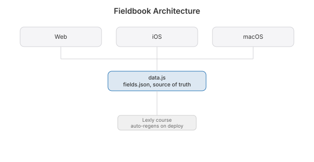

<p align="center"></p>

# Fieldbook

  [](https://github.com/nulljosh/labs/tree/main/fieldbook)

Nobody ever shows you the whole map. School hands you a few rooms and never the floor plan. You can finish a degree and still not know what topology is, or that the kidney sets your blood pressure, or that most physicists study materials. That's the gap.

Fieldbook is one page. Every field of science and math, a few hundred words each: what it studies, the four ideas that matter, and the thing most people get wrong. Read it top to bottom in an afternoon. "Oh, so that's what linear algebra is for." That's it. That's the whole product.

An encyclopedia is a warehouse. This is the map on the wall by the door.

v0 is the map. v1 adds a question per field so you can check you got it. After that, the same treatment for anything worth learning alone.

```
open index.html
env -u CLOUDFLARE_API_TOKEN npx wrangler deploy
https://fieldbook.jaybulb.com
```


## Architecture


