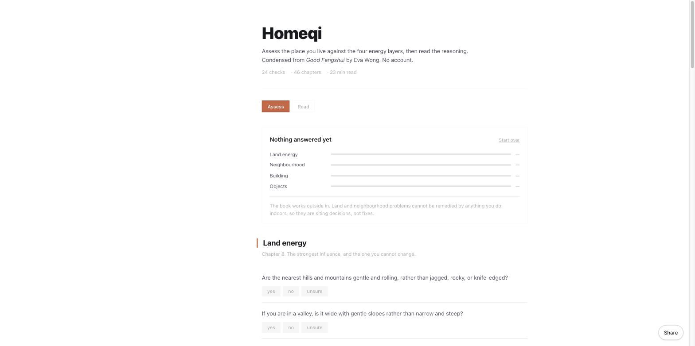
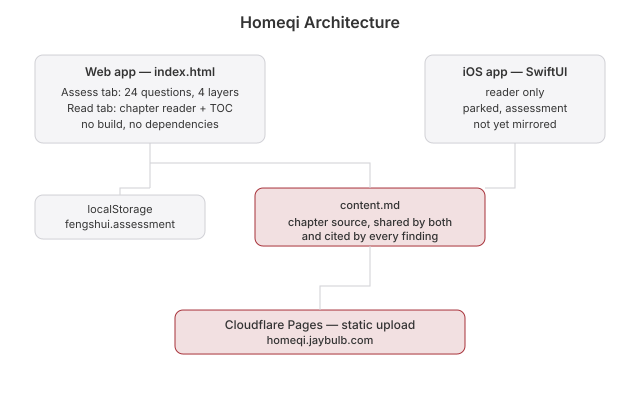

# Homeqi

 

**Live:** https://homeqi.jaybulb.com

Is the place you live any good? Answer 24 questions and find out, with the book's own reasoning behind every answer. Condensed from *Good Fengshui* by Eva Wong.

## Screenshots

## What it does

The book is Form School. Its chapters are already checklists. The **Assess** tab turns them into 24 questions across the four layers the book works through, from the outside in:

| Layer | Chapter | What it covers |
|---|---|---|
| Land | 8 | Hills, valleys, waterways, discontinuities, plant and animal life |
| Neighbourhood | 9 | Public space, traffic, upkeep, land-use mix, how it feels to walk |
| Building | 10 | Proportion, materials, floor plan, light and air, connection |
| Objects | 11 | Transmission lines, towers, industrial structures, view, clutter |

Yes, no, or unsure. Every worrying answer shows the book's reasoning and links into the chapter it came from. Land and neighbourhood come first and are marked as siting decisions. The book is blunt about it: nothing you do indoors fixes them.

Answers stay in `localStorage`. No account. No backend. No build step.

## Files

- `index.html`: the whole app. Assessment, reader, questions
- `content.md`: the chapter text, shared by web, iOS, and watchOS
- `tokens.css`: the house design tokens

Self-check: open `index.html?selftest` and read the console.

## iOS App

`ios/Homeqi` is a native SwiftUI reader. It's parked, and it doesn't have the assessment yet. See `roadmap.md`.

## Apple Watch App

`watchos/HomeqiWatch` is a standalone watchOS companion — no iPhone pairing required (`WKWatchOnly`). It's the same chapter reader as the iOS app: browse the book's chapters and read them on your wrist. Fully on-device, reading the same bundled `content.md`; no backend, no networking. Build with `xcodegen generate` in `watchos/`.

## Roadmap

See `roadmap.md`.

## Whitepaper

[Technical whitepaper](WHITEPAPER.md)

## Architecture

