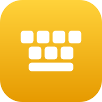
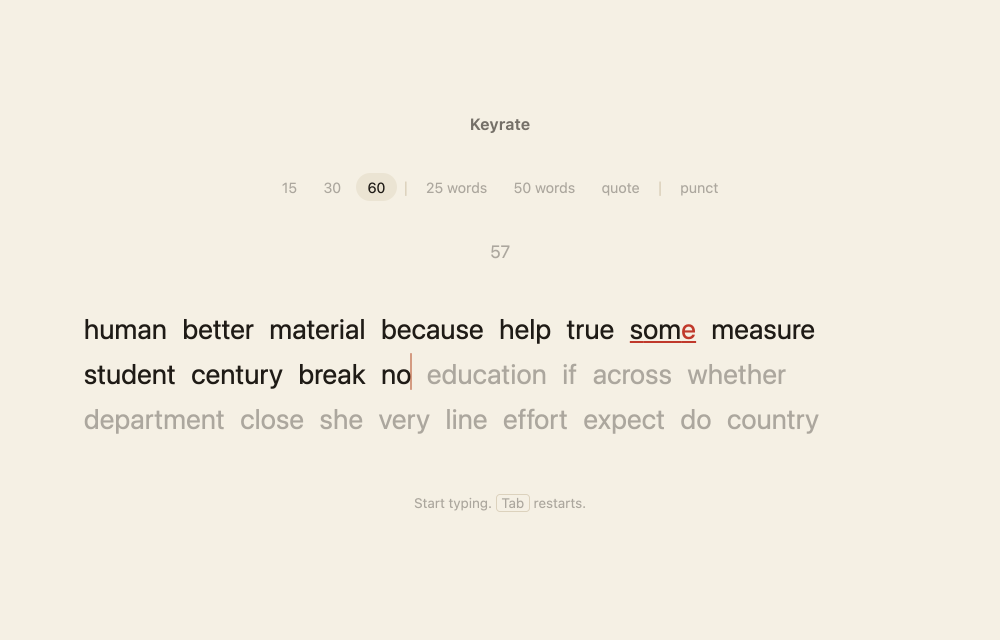
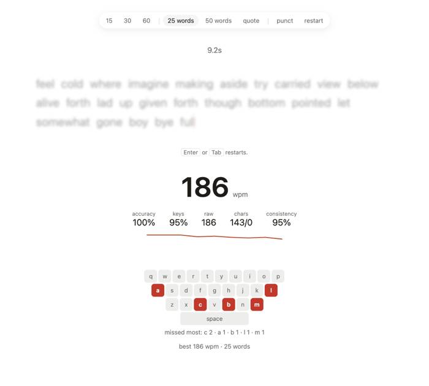
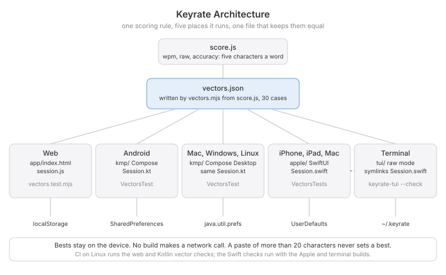

 [](https://github.com/nulljosh/labs/actions/workflows/keyrate-test.yml) 

Every typing test tells you how fast you are. Keyrate shows you why you are not faster.


## What it does

Words appear. You type them. Then the result draws a keyboard with the five keys you miss most lit up, and a line of your speed second by second.



It blames the key you should have pressed, not the one you hit. A slip you fix still counts, because it still cost you time. Wrong letters go red. Backspace into a bad word to fix it. Tab restarts. Your best per mode stays on your device.



## Words of its own

The word list is the thousand most common words across twenty public domain novels, counted for this project. Quotes come from writers long out of copyright.

## Platforms

| Where | What | Status |
|---|---|---|
| Web | [keyrate.jaybulb.com/app](https://keyrate.jaybulb.com/app) | Live |
| iPhone, iPad, Mac | `apple/`, SwiftUI | Not on the App Store yet |
| Android | `kmp/`, Compose | Not on Google Play yet |
| Mac, Windows, Linux desktop | `kmp/`, Compose Desktop (Dmg, Msi, Deb) | Builds, not released yet |
| Terminal | `tui/`, `swift run keyrate-tui` | Builds, Homebrew formula pending |

Every one of them checks itself against the same `vectors.json`, so a score means the same thing everywhere.

## Run it

```
15 / 30 / 60 seconds, 25 / 50 words, or a quote
punct          capitals, punctuation, numbers
Tab            restart
Enter          restart after a result
```

```
node --test
npx wrangler deploy
```

Live at [keyrate.jaybulb.com](https://keyrate.jaybulb.com); the test itself is at [/app](https://keyrate.jaybulb.com/app).

**Android and desktop:** `cd kmp && ./gradlew :composeApp:run` opens the Windows, Mac and Linux app, `:composeApp:assembleDebug` builds the Android one. Same scoring as the web, same tests.

**iPhone, iPad and Mac:** `cd apple && xcodegen generate`, then open `Keyrate.xcodeproj` (`xcodebuild test -scheme Keyrate -destination 'platform=macOS'` runs the tests).

**Terminal:** `swift build && ./.build/debug/keyrate-tui "target text" "typed text" 3.2` — see [tui/](tui/)

## Architecture


