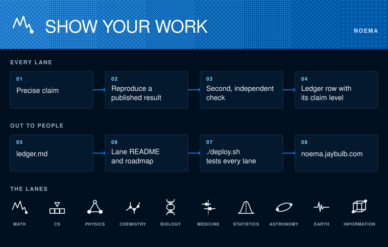

# Noema

A small lab for every STEM field, one lane at a time. Exact questions, fixed bounds, checks that can fail, and claims that stay as small as the evidence.

[noema.jaybulb.com](https://noema.jaybulb.com) · [Math](https://noema.jaybulb.com/math/) · [Biology](https://noema.jaybulb.com/biology/)

The look, in one sheet: [brand/BRAND.md](brand/BRAND.md).

## Lanes

Ten are live. Each is plain Python with the standard library, except biology, which needs Biopython. Tests run the same way everywhere: `cd <lane> && python3 -m unittest discover -s tests`.

| Lane | What it studies |
|---|---|
| [math](math) | Collatz first descent, Goldbach, tiny SAT formulas, three Lean lemmas, the residue tree |
| [cs](cs) | Busy Beaver, the Placid Platypus sequence, and three other integer sequences past where OEIS stops |
| [physics](physics) | Exact 2D Ising energy counts on wrapped grids, checked against Kaufman's formula |
| [chemistry](chemistry) | Alkane isomer counts to 100 carbons, checked against OEIS A000602 |
| [biology](biology) | Every one-base change in human beta-globin (HBB), checked against UniProt. Needs `uv run` |
| [medicine](medicine) | Landmark trials recomputed from their printed counts, and registry results checked against themselves |
| [statistics](statistics) | The birthday problem and coupon collector, exact fractions checked by simulation |
| [astronomy](astronomy) | Kepler's third law on every planet in the NASA Exoplanet Archive |
| [earth](earth) | The Gutenberg-Richter b-value on the USGS earthquake catalog |
| [information](information) | Largest binary codes A(n, d) by exhaustive clique search |

## How a lane works

State one question. Compute inside a fixed bound. Check it a second way with code that shares nothing with the first. Keep failures visible. Say what was observed apart from what was proved.

No model calls, no background jobs, no automatic pushes.

Results are in the discovery ledger, [ledger.md](ledger.md). Most rows reproduce known work, which is how an engine earns trust before it is pointed at anything new.

[roadmap.md](roadmap.md) holds what is next, including the fields with no folder yet. [docs/LOOP-HANDOFF.md](docs/LOOP-HANDOFF.md) restarts a loop.

`./deploy.sh` tests every lane, assembles one site and deploys it with wrangler. Git pushes do not deploy.

For the plain-language background on fields like these, see [Fieldbook](../fieldbook).

Independent and unaffiliated with Anthropic or Apple. MIT.
