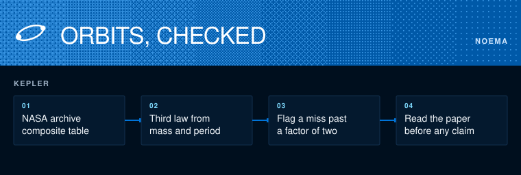

# Noema astronomy

Does every planet in the NASA Exoplanet Archive obey Kepler's third law?



```sh
python3 -m unittest discover -s tests
python3 kepler.py fetch PS_JSON && python3 kepler.py PS_JSON
```

`kepler.py` reads the composite planet table, works the orbital period out of the star's mass and the semi-major axis, and lists the planets whose posted period misses it by more than a factor of two.

An outlier is a contradiction inside the posted numbers, not a claim about the planet. Where a row disagrees with its own paper, the row stays an open note until someone reads the full text. The open notes are in [docs/KEPLER.md](docs/KEPLER.md).
