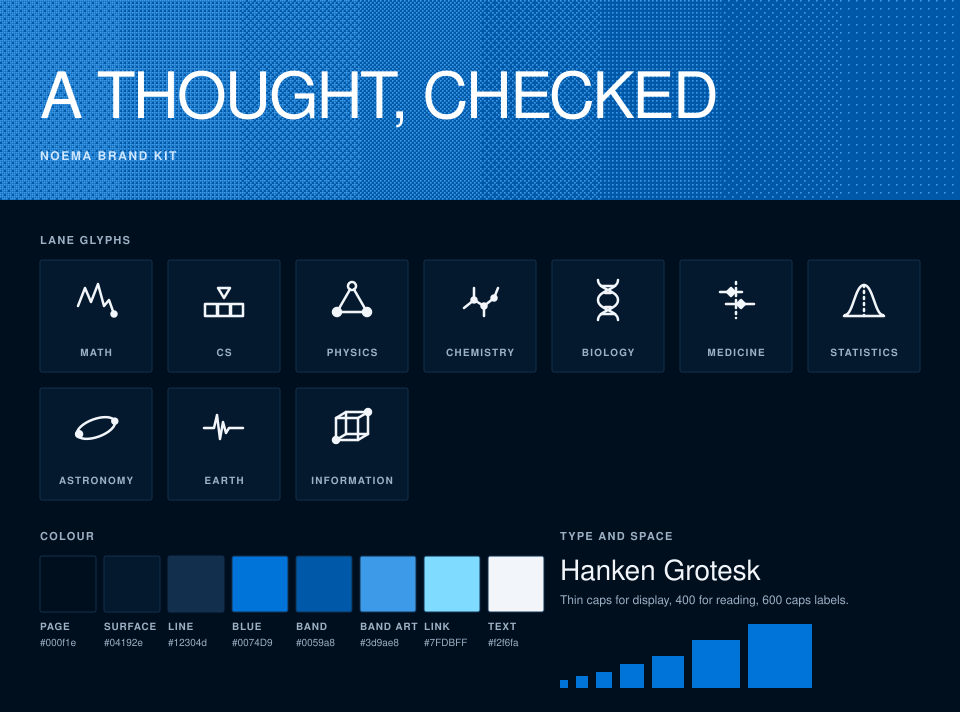

# Noema brand

One lab, one look. A navy page inside a thin blue frame. Giant thin caps. Tiny caps labels. One electric band carrying public-domain engravings cut into dots. Everything here comes from `tokens.css` and `../scripts/brand.py`, so change it there and rerun.

## Colour

clrs.cc, so the blues match the logo.

| Role | Hex |
|---|---|
| Page | `#000f1e` |
| Surface (cards, boxes) | `#04192e` |
| Line (rules, borders) | `#12304d` |
| Blue: buttons, the frame, wires | `#0074D9` clrs.cc blue |
| Band | `#0059a8` |
| Band art (the dots) | `#3d9ae8` |
| Link | `#7FDBFF` clrs.cc aqua |
| Text, then secondary text | `#f2f6fa`, `#9db0c4` |

No purple, no teal, no gradients except the dithered fades.

## Type

Hanken Grotesk, a proportional grotesque under the SIL Open Font License, loaded from Google Fonts with the system font behind it. Display is weight 100 in caps with tight tracking. Reading text is 400 at 15 on 22. Labels are 600 caps at 11 with wide tracking. Headings are 300.

## Space

An 8 point grid: 8, 16, 24, 32, 48, 64, 96, with 12 for tight pairs. Cards pad 24 and sit on 1 pixel rules. One small radius, 2, for buttons, boxes and swatches. Buttons are 36 high, 56 for the big ones.

## Glyphs

One per lane, drawn on a 48 grid with one 2.5 stroke and round ends. Each is a picture of what the lane studies: a Collatz path falling home, a tape and its head, a frustrated triangle where two spins agree and the third cannot, a branched carbon tree, the double helix, a forest plot, a bell curve and its mean. They live in `glyphs/` and tint with CSS masks.

## Dither

The engravings are cut into Floyd-Steinberg dot masks by `../scripts/dither-art.py` and tinted with the band art colour. The diagrams use a 4 by 4 Bayer screen that fades in eight steps across the band. `--dither` in `tokens.css` is the same screen for any other surface.

## Diagrams

Every `architecture.svg` in the lab is written by `scripts/brand.py`: the band with the lane's glyph and name, then numbered square boxes joined by blue wires. Add a lane by adding a row to `DIAGRAMS`.
