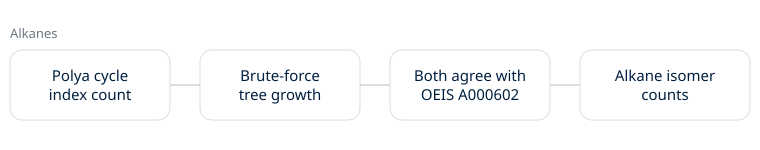

# Noema Chemistry Technical Whitepaper

**v0.1.0** | October 2026

The chemistry lane counts alkanes: how many different molecules can be built from n carbon atoms, each carbon bonded to at most four others, with hydrogens filling the rest. The answer is OEIS A000602.

## The core mechanic

Two methods count the same thing. The exact one builds rooted alkyl groups from Pólya's cycle index, then a centroid formula turns them into unrooted trees with at most four bonds per carbon. The brute-force one grows every tree one carbon at a time and keeps one canonical string per shape.

## Results

The two agree for n = 1 to 12. The formula runs to n = 100, and every value matches the OEIS b-file for A000602, kept offline in `benchmarks/`. Results go to `benchmarks/alkanes-latest.json`. This is a reproduction, not new work.

## Next

Stereoisomers or alcohols (OEIS A000628, A000598), with the same two-method check.

MIT License · Copyright 2026 Joshua Trommel.
