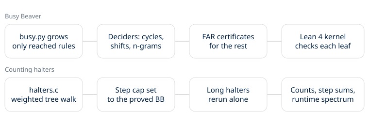

# Noema Computer Science Technical Whitepaper

**v0.3.0** | October 2026

The computer science lane asks how long small Turing machines can run before they stop. It rebuilds the known Busy Beaver values from scratch, proves the small ones in Lean, then uses the same machine tree to count every halting machine and add up how long they all run.

## The core mechanic

A machine is grown as a tree. A run from a blank tape starts with no rules. When it reaches a state and symbol with no rule yet, the tree branches over every rule it could have, and only those. A machine that never reaches a rule never needs one, so most of the space is never built.

Each branch ends one of three ways. It halts, a decider proves it never halts, or it hits the step cap and becomes a holdout. A holdout is unfinished work, never a proof.

## Deciders

A repeated configuration is a cycle. A translated cycler reaches a new edge of the tape in a state it had at an earlier edge, with the same nearby cells, so it repeats forever while moving. Backward reasoning shows no configuration can lead to a halt. The n-gram closed position set abstracts the tape to the nearest blocks on each side and closes that set under the rules. FAR certificates give a finite automaton that accepts every reachable tape and no halting one.

## What is decided here

BB(2) = 6, BB(3) = 21 and BB(4) = 107, with no holdouts left. These reproduce Lin and Rado (1965) and Brady (1983). BB(2,3) = 38 too.

## What is machine-checked

Lean 4 checks the cycle and translated-cycler deciders once as theorems, then applies them to every case at 2 and 3 states. All 41 FAR certificates pass `decide +kernel` under one soundness theorem. A checker replays the whole tree inside Lean, so BB(2) = 6, BB(3) = 21 and BB(2,3) = 38 are proved in full. `Count2.lean` then lists all 20,736 two-state tables and proves that 9,784 halt, with halting steps adding up to 13,504: A004147(2) and A386859(2), machine-checked. At 3 states `CountTree.lean` proves the weighted tree counts every one of the 16^6 tables, so A004147(3) = 7,571,840, A386859(3) = 13,141,792 and the 21 halting times are machine-checked too. No `sorry`, no `native_decide`, axioms propext and Quot.sound only.

## Counting halters

`halters.c` walks the same tree with weights, so each leaf stands for every full machine that agrees with it. Rules a run never reaches are counted, not built. The step cap is the proved Busy Beaver value, so a run that passes it never halts. Machines that pass 2,000 steps are each rerun alone by a second simulator.

At 5 states it counts 26,751,695,615,616 halting machines, matching OEIS A004147(5) and Ligocki's separate count. Their running times add up to 64,068,865,333,248 steps, a term OEIS A386859 did not have. The halting times take 1, 6, 21, 79 and 1,207 distinct values for 1 to 5 states, which answers a question Aaronson asks in The Busy Beaver Frontier, section 5.9. `runtimes.py`, a plain walk with no deciders that shares no code with `halters.c`, gets the same spectrum and counts through 4 states. Both new numbers are computed, not proved, and wait for OEIS review. The 5-state runner-up, 23,554,764 steps, is Marxen and Buntrock's.

## Placid Platypus

The same walk records the ones each halting machine leaves. Every count from 0 to 73 is reachable with 5 states and 74 is not, the smallest number no 5-state machine prints, a value we found nowhere in print. With 6-state witnesses for the gaps, PP(n), the fewest states that print exactly n ones (OEIS A399346), is now known for n up to 181, where OEIS had 37. A candidate, computed, not proved in Lean.

## Circular tapes

A 2-state machine on an n-cell ring can only be in 2^(n+1) configurations once the ring is turned to keep the head at cell 0, so one memoized pass over that graph settles every start. This adds a(20) to a(27) to OEIS A394183 and shows an even-n pattern, (n^2 - 3n + 8)/2, from n = 14 on. Computed, with the old terms reproduced.

## Rule 110

On a ring of n cells rule 110 is a map on 2^n configurations, so one walk finds every cycle. This takes OEIS A332717 and A332718 from 21 rows to 34, with every row's maximum matching A204371.

## Sorting networks

`sortnet.py` finds the fewest comparators that sort n inputs by searching over the sets of 0-1 vectors a network can still output. It gets 0, 1, 3, 5, 9, 12 and 16 for n = 1 to 7, matching OEIS A003075. A reproduction.

## Limits

BB(5) was proved by the bbchallenge collaboration in Coq in 2024. This lane reads toward that, it does not claim it. Counts above 3 states are computed, not checked in Lean. No universal claim comes from a finite run.

MIT License · Copyright 2026 Joshua Trommel.
