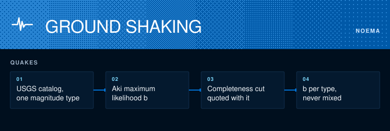

# Noema earth science

How fast do earthquakes get rarer as they get bigger?



```sh
python3 -m unittest discover -s tests
python3 quakes.py fetch DIR 2020 2025 && python3 quakes.py DIR
```

`quakes.py` reads the USGS catalog and estimates the Gutenberg-Richter b-value with Aki's maximum-likelihood formula. Near 1 means each step up in magnitude is about ten times rarer.

Two rules keep the number honest. Quote b per magnitude type, because mixing mb and Mw changes the answer. Quote the completeness magnitude beside it, because small quakes go unrecorded and drag b down.
