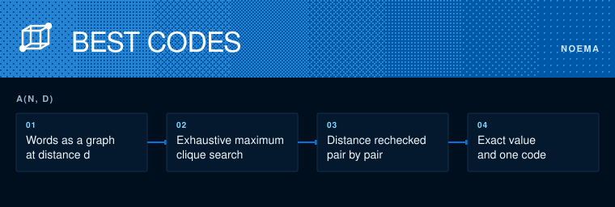

# Noema information engineering

How many codewords of length n can you have if every pair differs in at least d places?



```sh
python3 -m unittest discover -s tests
python3 codes.py 8 3
```

That count is A(n, d). `codes.py` treats the words as a graph, joins two when they are far enough apart, and finds the largest clique by exhaustive search. It prints a code that attains the answer, and the tests recheck every pair distance by distance.

An exhaustive search gives an exact value. A heuristic one gives only a lower bound, and says so. Check against Brouwer's published tables.
