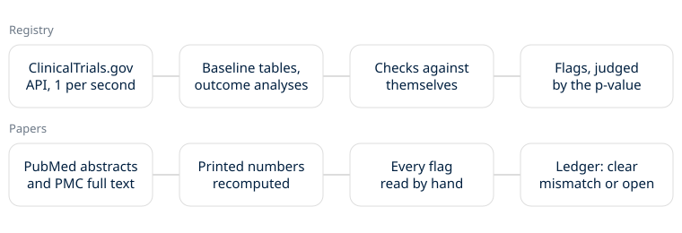

# Noema Medicine Technical Whitepaper

**v0.3.0** | October 2026

The medicine lane checks published trial numbers against themselves. A paper or a registry entry often prints the same fact twice, as counts and a percent, a ratio and its arm rates, an interval and a P value. When the two cannot both be right, one of them is wrong. The lane finds those cases, then reads each one by hand.

## The core mechanic

Pick one pair of numbers that must agree. Write the rule that links them, with every honest reason they might not: rounding, missing data, adjusted models, one-sided tests, a different scale. Run it over every source. Anything the rule still flags is read by hand. A flag is an open note until the full text is read, and a clear mismatch only when nothing in the paper explains it.

## Sources

PubMed trial abstracts from 2015 to 2024, 235,860 of them, fetched as NCBI asks, at most three requests a second. ClinicalTrials.gov results through its public API, one request a second: baseline tables and 329,322 outcome analyses. Linked papers come from PubMed and PubMed Central full text.

## Checks in the abstracts

Percents against counts, P values against test statistics, ratios against their intervals, ratios against the arm rates printed beside them, number needed to treat against risk differences, Cohen's d against means and SDs, hazard ratios against medians, and SDs that no data could produce. Each check has a README section with its counts and every flag that survived.

## Checks in the registry

Baseline Totals against their arms. 407 Total SDs in 296 trials are impossible for any pooling of the arms. 328 Totals land on the plain average of the arm means, which is right only for equal arms, where chance gives about 27.

Outcome analyses. A difference with a lopsided interval that becomes symmetric when one limit changes sign looks like a lost or stray minus. The P value then decides. It backs the flip 61 times in 52 trials and backs the posted interval 28 times, the rate chance alone gives. Two linked papers print the flipped interval the P value expects. One paper repeats the slip.

Spread labels. An interval for the difference between two arms has a width set by the arms. As SDs, the spreads predict one width. As standard errors, they predict one about root n times wider. Of 7,685 SD-labelled intervals that fit either, 292 in 90 trials fit standard errors, and they pile up right on that prediction. Linked papers agree. Across every flagged trial, 15 of the 16 papers that print the flagged values and name the spread call it a standard error. The 16th says SD, but its interval is not the one the registry posts. An earlier false flag from mixed units is now ruled out by a scale check. In baseline tables, 71 impossible Total SDs fit once the arm spreads are read as standard errors.

## Claim levels

Observed means the rule flagged it and a person read it. Written means an argument on paper. Literature means someone else published it. These are never blurred. Most results here are new observations, small.

## Limits

No clinical advice. No claim about any drug or treatment. A mismatch says a number is wrong somewhere, not which one or why. Nothing here accuses an author. Every API is used at the rate it asks for, with no personal email sent.

MIT License · Copyright 2026 Joshua Trommel.
