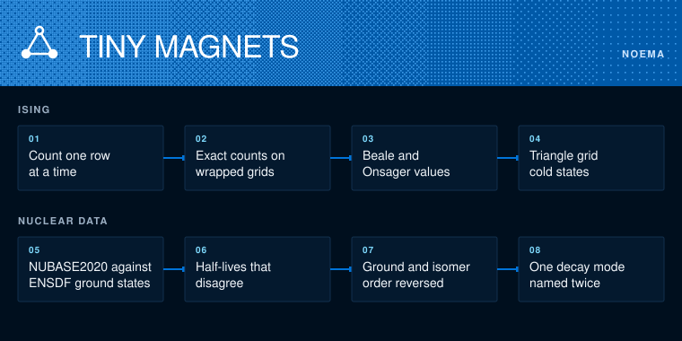

# Noema Physics Technical Whitepaper

**v0.1.0** | October 2026

The physics lane counts the states of the Ising model exactly on small grids that wrap around at the edges. It reproduces the known square-grid counts, then counts the coldest states of magnets on a triangle grid, where no arrangement can please every pair.

## The core mechanic

`ising.py` builds the count one row at a time. Each row's arrangement is a state, and a transfer step adds the next row and tallies how many neighbour pairs disagree. The grid is never listed, so 8x8 (2^64 arrangements) takes about a second and 10x10 (2^100) about two and a half minutes.

## Checks

Every count is checked three ways: listing every state for grids up to 4x4, Kaufman's 1949 formula for the same finite grids, and facts any answer must obey (the total is 2^N, one flipped magnet gives exactly 2N arrangements). The 5x5 triangle count, 3,630, was also checked by listing all 33 million states.

## Results

On the square grid, the temperature where the grid soaks up heat fastest falls from 2.511 at 2x2 to 2.345 at 10x10, heading toward Onsager's 2.269. That is a trend on small grids, not a measurement of the limit. These reproduce Beale (1996).

On the triangle grid with the rule flipped, 9x9 has 547,003,370,634 equally cold arrangements. The leftover disorder per magnet heads to 0.3231, Wannier's value as corrected in his 1973 erratum. TRIANGULAR.md gives an exact formula for every grid size, built from Wendt's determinant. That formula is the lab's open candidate in physics. It still needs a deeper literature search and an outside reader.

## Limits

Finite grids only. No claim about the infinite limit beyond what is already known. The OEIS draft in `OEIS-DRAFT.md` waits on Joshua.

MIT License · Copyright 2026 Joshua Trommel.
