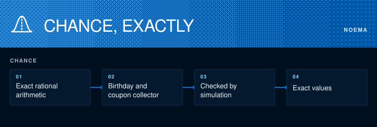

# Noema Statistics Technical Whitepaper

**v0.1.0** | October 2026

The statistics lane works out classic chance problems exactly, as fractions with no rounding, and checks each one against a seeded simulation.

## The core mechanic

`chance.py` computes each probability with exact rational arithmetic, then rolls simulated dice a few hundred thousand times with a fixed seed. The exact answer must sit within a few standard errors of the simulated one.

## Results

Birthday problem: with 23 people the chance that two share a birthday is 50.7297%, and 23 is the smallest group that passes a half. Coupon collector: seeing every face of a die takes 14.7 rolls on average, and 50 kinds of coupon take about 225 draws. Both are textbook results, reproduced so the lane has a tested base.

## Next

The birthday problem's harder cousin: the chance that three people share a birthday, where the smallest group past a half is 88, computed exactly and checked against the published value.

MIT License · Copyright 2026 Joshua Trommel.
