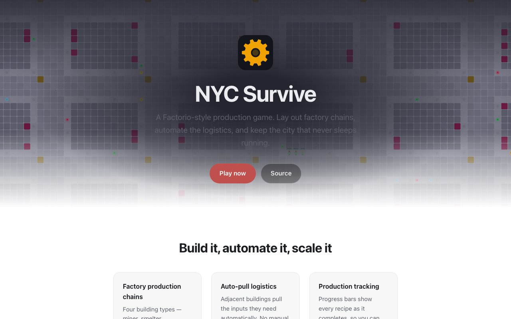

 [](https://github.com/nulljosh/labs/actions/workflows/nyc-test.yml) 

Reclaim Times Square.

NYC Survive is a colony survival game. You run a small group of survivors in the middle of the city. Gather food and materials, build shelters, and let new survivors move in when there is a bed for them. Scavengers come every third night. You decide what everyone does.

**[nyc.jaybulb.com](https://nyc.jaybulb.com)** · **[Play in the browser](https://nyc.jaybulb.com/app/)** · **[App Store](https://apps.apple.com/app/id6782618198)**



## Features

- **Survivors move in.** One arrives each day when there is a free bed and 10 food. Shelters add beds. The colony holds up to 20.
- **Five resources.** Food, power, materials, oxygen and cash. Hunger and oxygen drain every survivor, so the stockpile has to keep up.
- **Buildings cost upkeep.** Each building uses one material every 10 seconds at normal speed to keep running. Run out and it breaks until you can pay again.
- **Raids.** Every third night at 22:00, scavengers take a fifth of your food, materials and cash. A survivor on patrol near your buildings turns them back.
- **You give every order.** Click a survivor, or drag a box around several. Click the ground to move them. Click a resource to gather it. Nobody works on their own.
- **Win.** Have 15 survivors alive, an average level of 8, and one at level 10. A full game takes about an hour and a half.
- **Saves.** Autosave runs about once a minute. There are three save slots.
- **Apple.** iPhone, iPad and Mac. The Mac app has a resizable window and a full screen switch in Settings.
- **Web.** The same game runs in a browser at [/app](https://nyc.jaybulb.com/app/), with WebMCP tools for browser agents.
- **Apple Watch.** A quick reference for building costs, survivor traits and weapon stats.

## Run

```bash
xcodegen generate && open NYCSurvive.xcodeproj
```

Needs Xcode 16 or later. The app targets iOS 17 and macOS 15.

Other ways in:

- **Web.** `cd web && python3 -m http.server 8000`, then open http://localhost:8000. Modules need a server, so `file://` will not work.
- **Headless playthrough.** `scripts/playthrough.sh 200` plays the bot to the win with no window.
- **Recorded demo.** `"NYC Survive.app/Contents/MacOS/NYC Survive" -demo 200` runs the tutorial, then the bot at 200 ticks a second with the window on top.
- **Apple Watch.** `cd watchos && xcodegen generate && open NYCSurviveWatch.xcodeproj`

## Tests

```bash
node --test
xcodebuild test -project NYCSurvive.xcodeproj -scheme NYCSurvive -destination 'platform=macOS' -only-testing:SimTests
```

`node --test` runs the web tests, including `web/winnable.test.mjs`, which plays the game to a win. The Swift tests live in `Tests/SimTests.swift`.

## Docs

- [Controls](docs/CONTROLS.md): every key, click and tap.
- [Whitepaper](WHITEPAPER.md): how the game works and why.
- [Architecture](docs/ARCHITECTURE.md) and [Web API](docs/API.md).
- [Changelog](CHANGELOG.md).

Found a security problem? Email trommatic@icloud.com. See [SECURITY.md](SECURITY.md).

## Privacy

NYC Survive collects nothing. Saves stay on your device. There are no accounts, no analytics and no network calls. The full [privacy policy](https://nyc.jaybulb.com/app/privacy) is on the site.

## License

Apache License 2.0. See [LICENSE](LICENSE). Copyright 2026 Joshua Trommel.

The NYC Sans typeface is Inter, renamed. It stays under the SIL Open Font License 1.1, see [Resources/Fonts/OFL.txt](Resources/Fonts/OFL.txt).
