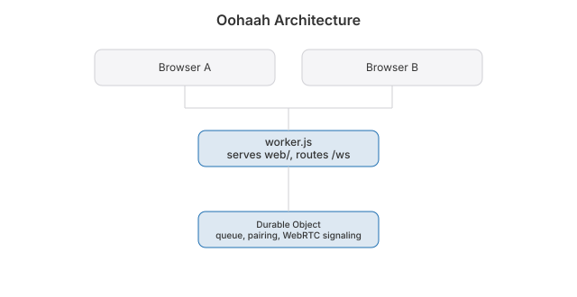

 

**Live:** https://oohaah.jaybulb.com

Fifteen seconds of video with a stranger. Then you both decide.

Both of you tap More time or the call ends itself. Both tap Keep and you swap handles. Ooh ooh, ah ah: fifteen seconds to say hello.

## Features

- One tap matches you with one person. No account, no profile.
- A fifteen second clock that only both of you can extend, kept on the server so nobody can stall it.
- Keep: handles are swapped only when both of you ask.
- Report cuts the call; three reports in a day bans that person for a day. Block keeps you apart for good.
- Slurs are masked in chat and handles before a stranger sees them.
- Video goes peer to peer. The server never sees it and nothing is recorded.
- Web, iPhone and Mac, all in one lobby.

## How it is built

- `worker.js`: a Cloudflare Worker. Serves `web/` and hands `/ws` to one Durable Object that keeps the queue, pairs two sockets, runs the clock, relays WebRTC signaling, and stores reports, bans and blocks in SQLite.
- `web/`: the landing (`index.html`), the call (`app.html` + `chat.js`), privacy and terms.
- `ios/`: the SwiftUI app for iPhone and Mac. WebRTC comes from the `stasel/WebRTC` package. It speaks the same lobby JSON as the browser, so native and web users meet each other.
- `brand/`: icon, mascot, colours. See `brand/BRAND.md`.

## Run

    npx wrangler dev      # http://localhost:8787, open two tabs
    node test.mjs         # lobby logic: pairing, clock, keep, block, filter
    npm run qa            # two headless browsers make a real call
    npx wrangler deploy

    cd ios && xcodegen generate && open Oohaah.xcodeproj

## TURN

`/ice` hands out ICE servers. With no TURN key it returns STUN only, which connects most pairs but not symmetric NATs or strict cellular networks. To turn the relay on, make a TURN key in the Cloudflare dashboard (Realtime > TURN) and give the Worker both values:

    npx wrangler secret put TURN_KEY_ID
    npx wrangler secret put TURN_KEY_API_TOKEN

## Moderation

`GET /moderation` with `Authorization: Bearer <MODERATOR_TOKEN>` lists the last 100 reports and live bans. The token is in the macOS Keychain under `oohaah-moderator-token`.

## Architecture

