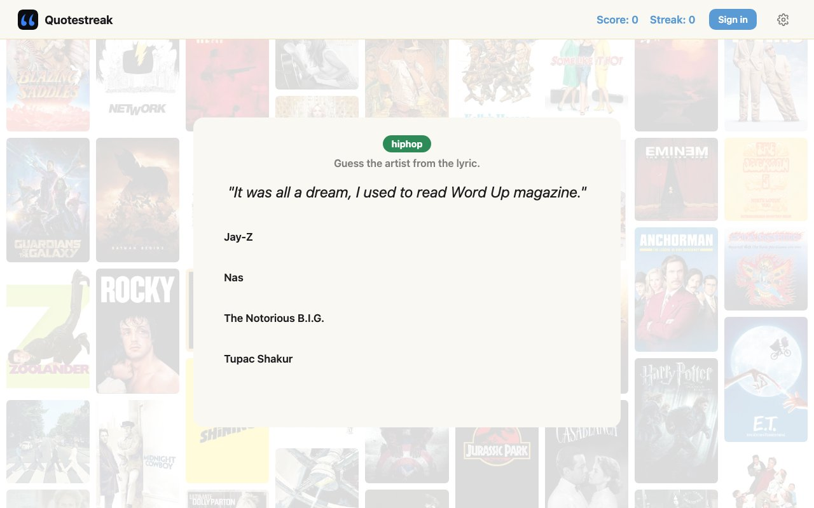
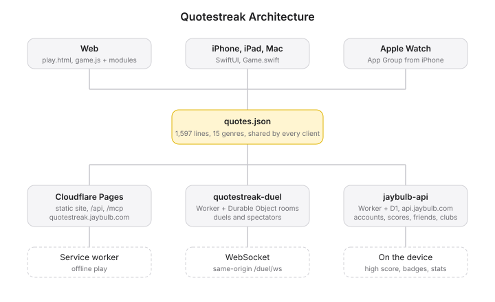

 

Here's the line. Name the movie.

Or the show, the game, the song or the book. 1,624 lines across 15 genres, from the 1930s to now, with a clock if you want one and a friend to beat if you have one. Dad's idea.

**[quotestreak.jaybulb.com →](https://quotestreak.jaybulb.com)** · **[Play →](https://quotestreak.jaybulb.com/play)**

<p>


</p>

## Features

**Guess.** Four choices or type it in. Hints if you turn them on. Filter by genre, decade and difficulty, where difficulty comes from what real players get right. Other ways to guess: who said it, finish the line, misquotes, timeline, poster and album reveal, name the year, and a marathon through every genre on three lives.

**Hands free.** Turn them on in Settings: Quip reads every line aloud, and you say the answer instead of tapping it.

**Speed round.** Ten seconds a line. Faster answers pay more.

**Daily Quote.** One line a day, the same for everyone, with a day streak.

**Play with people.** Send a friend your ten quotes as a challenge link, duel live, watch someone else's duel, enter the weekly cup, join a club, add friends and see a friends-only leaderboard.

**Keep score.** Fifty badges drawn around Quip, the mascot. Stats by genre and decade with a graph of your last fifty games. A share card for every game. A ranked season every quarter, with a Quip medal for each tier you reach.

**Everywhere.** Web, iPhone, iPad, Mac and Apple Watch. The next app update adds a Daily Quote widget for the home screen, lock screen and Mac desktop, the Daily Quote on the watch, and live duels on the phone with both scores on the lock screen. One account on every platform: email, Apple or Google.


## Run

```
sh scripts/build-site.sh && npx wrangler pages dev dist
```

Tests: `for t in *.test.js; do node $t; done`

## Docs

[Architecture](docs/ARCHITECTURE.md) · [API and agent tools](docs/API.md) · [Whitepaper](WHITEPAPER.md) · [Roadmap](roadmap.md)



## License

MIT 2026, Joshua Trommel
